I build agent systems that keep running after I close the laptop: a personal fleet on my own machine, tool routing across model providers, and the plumbing that makes them recover on their own. I care more about whether a job survives a reboot than how it looks in a demo.

## Selected work

| Project | What it is | Stack |
| --- | --- | --- |
|  **[airdrop-tracker](https://github.com/oxbfnohom/airdrop-tracker)** 7 stars | Self-hosted agent that runs a research pipeline: it reads the Telegram groups you already follow, scores new leads, keeps per-project task lists, and re-checks finished work on a schedule. SQLite, one file, no external queue. | `Next.js` `TypeScript` `SQLite` |
|  **[all-about-crime](https://github.com/oxbfnohom/all-about-crime)** 9 stars | Telegram bot that automates the boring parts of OSINT work: rotating proxies, virtual cards, throwaway mail, and OTP handling behind one command surface. | `Python` `Telegram` |

## Numbers

## Stack

`Python` `TypeScript` `Node.js` `Next.js` `SQLite` `Bash`
Model routing through OpenAI-compatible endpoints, with fallbacks and daily cost caps. Telegram bots and userbots carry most of the automation.

## Currently

- Keeping the agent fleet honest: retries, fallbacks, and cost caps before features
- A memory layer the agents can actually reuse, instead of re-reading the same context every run
- Writing down the parts that broke, because that is the only documentation I reread

## Elsewhere

[X / @OxbfnoHome](https://x.com/OxbfnoHome) · [Telegram bot work](https://github.com/oxbfnohom/all-about-crime)
